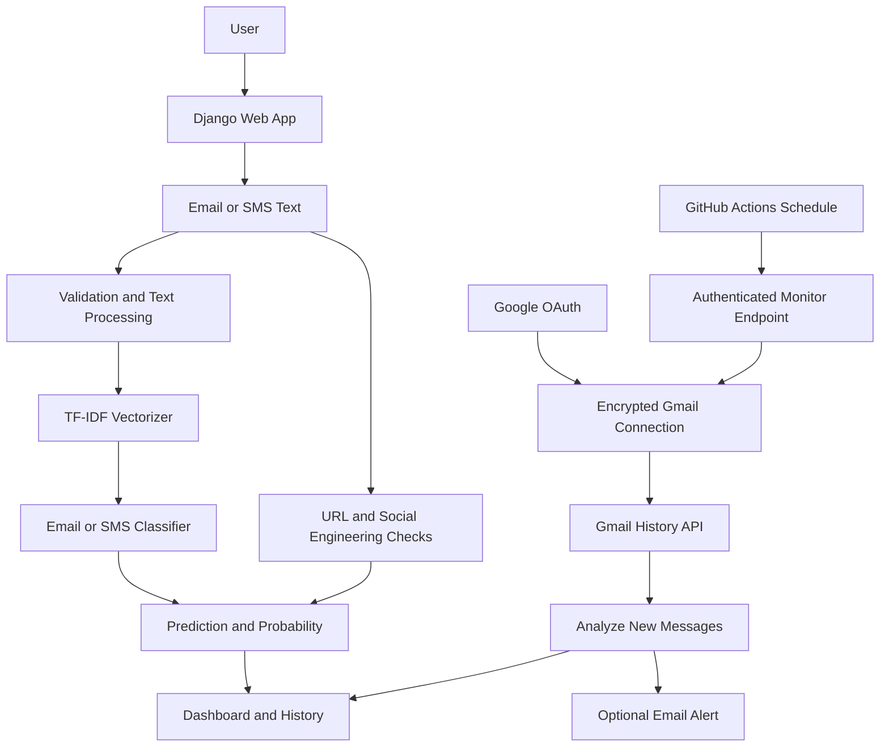

# CyberShield AI

**An AI-assisted phishing detection and Gmail security-monitoring project built with Django, scikit-learn, and the Gmail API.**

[](https://www.python.org/)
[](https://www.djangoproject.com/)
[](https://scikit-learn.org/)
[](LICENSE)

CyberShield AI is a learning and portfolio project that combines text-based phishing classification, suspicious-link indicators, user accounts, and optional Gmail inbox monitoring. It is designed to help users review potentially malicious messages; it is **not** a replacement for a mail provider's security controls or a guarantee that every phishing message will be detected.

## Contents

- [Highlights](#highlights)
- [How it works](#how-it-works)
- [Architecture](#architecture)
- [Machine-learning approach](#machine-learning-approach)
- [Gmail monitoring and privacy](#gmail-monitoring-and-privacy)
- [Technology stack](#technology-stack)
- [Repository layout](#repository-layout)
- [Setup and configuration](#setup-and-configuration)
- [Automated checks](#automated-checks)
- [Evaluation results and interpretation](#evaluation-results-and-interpretation)
- [Deployment notes](#deployment-notes)
- [Security considerations](#security-considerations)
- [Limitations and roadmap](#limitations-and-roadmap)
- [License](#license)

## Highlights

- **Email and SMS text classification:** separate trained scikit-learn model/vectorizer pairs are used for email and SMS/chat text.
- **NLP feature extraction:** TF-IDF converts message text into numerical features for classification.
- **Prediction details:** the application returns a predicted class and model probability scores.
- **Suspicious URL indicators:** checks for characteristics such as IP-address hosts, known URL shorteners, punycode, embedded credentials, deep subdomains, and plain HTTP. These are review indicators, not proof of maliciousness.
- **Social-engineering indicators:** message text is checked for patterns associated with urgency, fear, fake authority, and reward scams.
- **Web application:** Django provides account registration/login, message-analysis views, and a dashboard.
- **Optional Gmail integration:** a user can authorize a Gmail mailbox using Google OAuth. The monitor checks newly added messages after the saved Gmail history checkpoint.
- **Email alerts:** detected Gmail threats can trigger a notification to the CyberShield account owner through the configured Gmail API sender.
- **Scheduled monitoring:** GitHub Actions can call the protected Django monitoring endpoint on a 15-minute schedule.

## How it works

### Manual message analysis

1. A signed-in user submits email or SMS text.
2. The backend validates the input and selects the corresponding model and TF-IDF vectorizer.
3. The model predicts whether the text resembles phishing/spam or safe content.
4. The application also evaluates URL characteristics and selected social-engineering patterns.
5. The dashboard displays the result and supporting indicators.

### Gmail inbox monitoring

1. The user signs in to CyberShield AI and starts Gmail connection.
2. Google OAuth grants the application the configured Gmail read-only scope.
3. The application encrypts the refresh token before saving it in the database.
4. A scheduled GitHub Actions workflow sends an authenticated POST request to the Django monitor endpoint.
5. The backend retrieves Gmail history after the saved checkpoint, analyzes newly added messages, and records the result.
6. If a message is classified as phishing, the application attempts to email an alert to the CyberShield account owner.

## Architecture



## Machine-learning approach

The repository contains training scripts for two supervised text-classification pipelines:

- **Email:** TF-IDF features with Logistic Regression.
- **SMS/chat:** text cleaning, TF-IDF features (up to 5,000 features), and Logistic Regression.

The scripts expect locally available datasets. Dataset files and trained `.pkl` artifacts are excluded from Git by `.gitignore`; therefore a fresh clone does not currently contain everything needed to reproduce model training or run inference locally. See [model artifact and dataset notes](docs/MODELS_AND_DATASETS.md).

## Gmail monitoring and privacy

- Gmail access uses the read-only scope `https://www.googleapis.com/auth/gmail.readonly`.
- Refresh tokens are encrypted with Fernet before being stored in the application database.
- The monitor uses Gmail history checkpoints so it focuses on newly added messages rather than repeatedly scanning the whole mailbox.
- Message text is used temporarily for analysis. The monitoring code stores limited metadata and detection details, not the full email body or attachments.
- Attachments are not analyzed.
- Gmail-monitor history is configured for automatic deletion after 30 days.
- The monitoring endpoint requires an `Authorization: Bearer <secret>` header and accepts POST requests only.
- Outbound account-verification and threat-alert email delivery uses a separately configured Gmail API sender account. The sender mailbox and monitored mailbox are separate settings.

See [Security notes](docs/SECURITY.md) and [deployment configuration](docs/DEPLOYMENT.md) before setting up a real account.

## Technology stack

| Area | Technology |
|---|---|
| Backend | Python, Django |
| Machine learning | scikit-learn, Logistic Regression, TF-IDF |
| Data processing | Pandas, NumPy |
| Model persistence | Joblib |
| Gmail integration | Gmail API, Google OAuth 2.0 |
| Token encryption | Cryptography (Fernet) |
| Database | SQLite locally; PostgreSQL supported through `DATABASE_URL` |
| Frontend | Django templates, HTML, CSS, JavaScript |
| Production application server | Gunicorn |
| Scheduled monitoring | GitHub Actions |
| Hosting | Render (deployment configuration is maintained in the hosting dashboard) |

## Repository layout

```text
.
├── .github/
│   ├── scripts/                 # Temporary ML artifacts for CI tests
│   └── workflows/               # Regression tests and Gmail monitor schedule
├── assets/                      # Model evaluation charts and metric reports
├── backend/
│   ├── analyzer/                # Authentication, analysis, Gmail integration
│   ├── dashboard/               # Threat-history models and dashboard data
│   └── cybershield_ai/           # Django project settings and URL routing
├── chrome_extension/            # Experimental browser-extension client
├── docs/                        # Project, security, deployment, and model notes
├── ml_model/                    # Model training scripts
├── .env.example                 # Environment-variable template (no real secrets)
├── requirements.txt
└── README.md
```

## Setup and configuration

### Prerequisites

- Python 3.12 or a compatible version supported by the pinned dependencies.
- Git.
- The model artifacts and datasets described in [Models and datasets](docs/MODELS_AND_DATASETS.md) if you want to run inference or retrain locally.

### Create a local environment

From the repository root:

```bash
git clone https://github.com/syedamahvish03/cyberShieldai.git
cd cyberShieldai

python -m venv .venv

# Windows PowerShell
.venv\Scripts\Activate.ps1

# macOS / Linux
source .venv/bin/activate

python -m pip install --upgrade pip
pip install -r requirements.txt
```

Copy `.env.example` to `.env` and set a unique Django `SECRET_KEY`. For local development, set `DEBUG=True` and `ALLOWED_HOSTS=127.0.0.1,localhost`.

Then:

```bash
cd backend
python manage.py migrate
python manage.py runserver
```

Open `http://127.0.0.1:8000/`.

> **Important:** The current public repository intentionally excludes trained model files and source datasets. The application imports model artifacts during startup, so a clean clone requires those files to be supplied/generated before the full application can run. Follow [Models and datasets](docs/MODELS_AND_DATASETS.md); do not assume `pip install` alone is sufficient.

## Automated checks

Two GitHub Actions workflows are included:

- **Django regression tests:** runs Django tests with temporary test model artifacts generated by `.github/scripts/create_ci_test_models.py`. The temporary artifacts are for CI tests, not production model evaluation.
- **Gmail monitor:** runs on the schedule `7,22,37,52 * * * *` (approximately every 15 minutes) and can also be started manually. GitHub may delay scheduled runs.

A successful Gmail monitor run returns a JSON summary such as:

```json
{
  "status": "completed",
  "accounts_checked": 1,
  "emails_scanned": 6,
  "threats_found": 2,
  "errors": 0,
  "expired_gmail_history_deleted": 0
}
```

This is an example of one observed run, not a benchmark or a guarantee of future results. “Threats found” means the model flagged messages for review; it does not independently prove that those messages are malicious.

## Evaluation results and interpretation

The checked-in evaluation reports currently show the following results:

| Model | Accuracy | Precision | Recall | F1 |
|---|---:|---:|---:|---:|
| Email | 98.45% | 97.95% | 99.10% | 98.52% |
| SMS/chat | 97.03% | 99.04% | 89.60% | 94.08% |

Confusion matrices and ROC plots are available in [assets](assets/). These are historical evaluation outputs from the included reports, not a guarantee of real-world performance.

**Evaluation caveat:** the email training script currently fits its TF-IDF vectorizer before splitting the dataset into training and test sets. This can leak vocabulary information from the test split into training and make reported metrics optimistic. Re-run evaluation with a scikit-learn Pipeline fitted only on the training split before presenting these figures as a rigorous independent benchmark. The datasets and model artifacts are not included in this repository, so the reports are not independently reproducible from a fresh clone.

## Deployment notes

The application has been deployed to Render, and the Gmail monitor endpoint has been exercised successfully through GitHub Actions. Deployment depends on secrets and environment variables configured outside the repository. See [Deployment guide](docs/DEPLOYMENT.md).

The public demo may be unavailable or slow at times because of hosting-plan sleep/cold-start behavior, OAuth consent configuration, expired/revoked Google refresh tokens, or scheduler delays. Do not promise uninterrupted 24/7 availability.

## Security considerations

- Never commit `.env`, OAuth client secrets, refresh tokens, encryption keys, Django secret keys, database credentials, or monitor secrets.
- Use HTTPS and `DEBUG=False` in production.
- Restrict `ALLOWED_HOSTS` and configure trusted CSRF origins for the deployed domain.
- Use a dedicated Gmail sender mailbox for application notifications rather than a personal mailbox.
- Keep the Gmail monitor secret private; it grants access to trigger inbox processing.
- Do not use real or sensitive email content in screenshots, sample data, or public demonstrations.

See [Security notes](docs/SECURITY.md).

## Limitations and roadmap

Current limitations:

- The classifiers are traditional TF-IDF + Logistic Regression models and may miss novel or obfuscated attacks.
- A model probability is not a calibrated guarantee that a message is malicious.
- URL checks are heuristic indicators and do not query a live threat-intelligence feed.
- Gmail monitoring analyzes message text only; attachments are excluded.
- Monitoring depends on Gmail API availability, OAuth token validity, the hosting service, and the scheduler.
- GitHub Actions scheduled workflows are best-effort and can be delayed.
- The Chrome extension is experimental; its current manifest allows localhost backend access and it is not a published browser-store extension.
- Public model artifacts and datasets are not included, limiting clean-clone reproducibility.

Potential next improvements:

- Correct the email training data-leakage issue and add reproducible evaluation.
- Provide a documented, license-cleared model-artifact download or training workflow.
- Add integration tests for Gmail OAuth, history pagination, alert delivery, and scheduler failures.
- Move secrets to a managed secret store and document token rotation/recovery.
- Add a deployment health check and compact monitor responses.
- Expand URL analysis with a maintained threat-intelligence source.
- Package and test the browser extension against a deployed HTTPS API.

## License

This project is distributed under the Apache License 2.0. See [LICENSE](LICENSE).

## Maintainer

**Syeda Mahvish** · [GitHub](https://github.com/syedamahvish03)

---

If you are reviewing this project for hiring or academic evaluation, the most useful starting points are the architecture above, the Gmail monitoring implementation in `backend/analyzer/gmail_service.py`, the authenticated endpoint in `backend/analyzer/gmail_views.py`, and the scheduled workflow in `.github/workflows/gmail-monitor.yml`.
