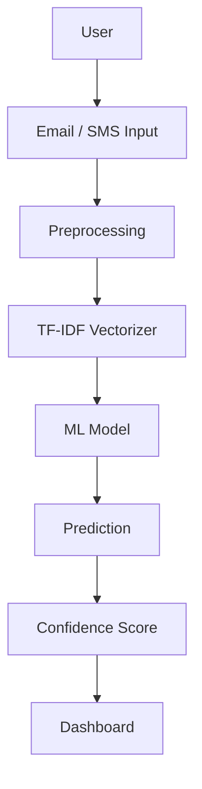
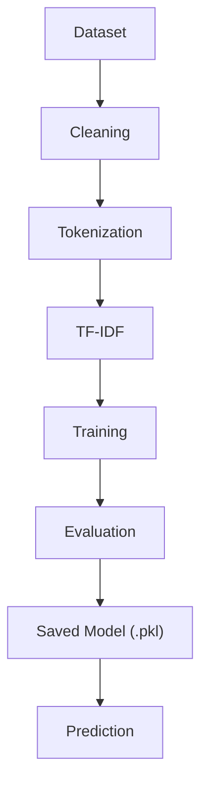
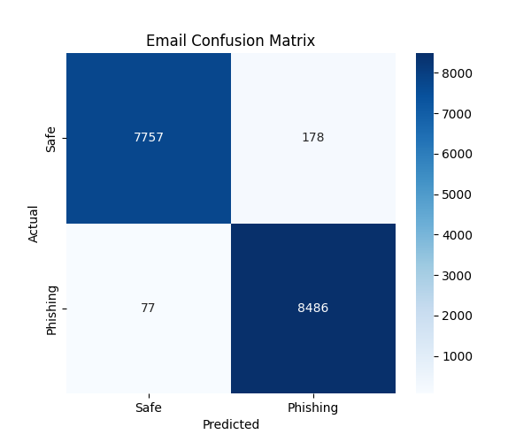
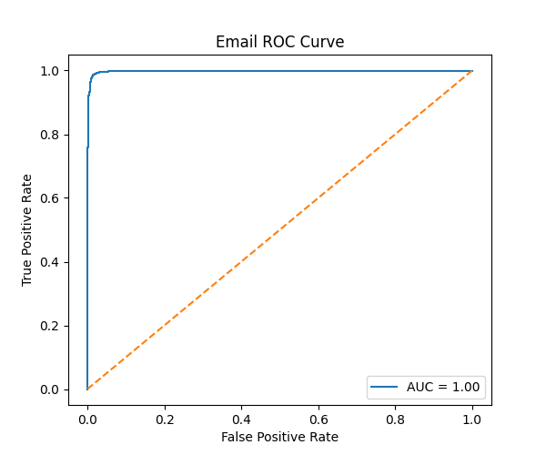
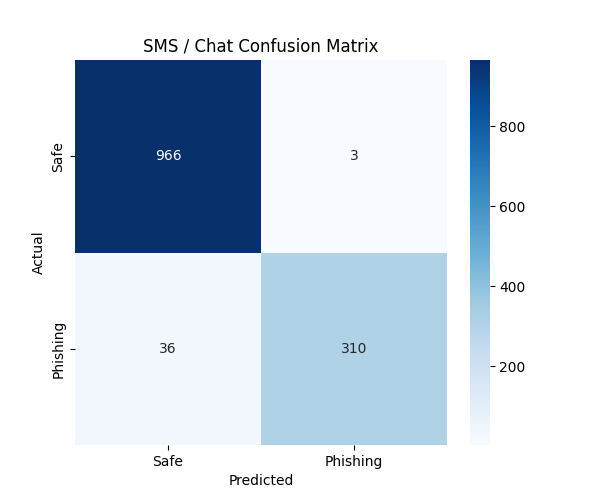
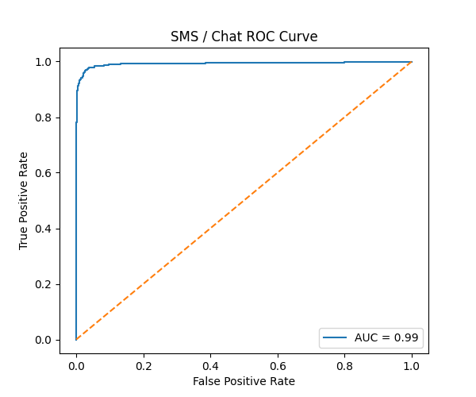

<<<<<<< HEAD
<div align="center">

# 🛡️ CyberShield AI

### AI-Powered Phishing & Social Engineering Detection Platform

[](https://www.python.org/)
[](https://www.djangoproject.com/)
[](https://scikit-learn.org/)
[](LICENSE)
[](https://github.com/syedamahvish03/cyberShieldai)
**CyberShield AI detects phishing emails and spam/phishing SMS messages using NLP-driven, machine-learning classification instead of static rule-based filtering.**

</div>

---

## 📖 Project Overview

**CyberShield AI** is a Machine Learning–powered cybersecurity platform built with **Django** that detects **phishing emails** and **spam/phishing SMS messages** using **Natural Language Processing (NLP)** and **supervised Machine Learning** models.

Phishing remains one of the most persistent and damaging attack vectors in cybersecurity. It doesn't rely on exploiting software vulnerabilities — it exploits human trust. Attackers continuously evolve their language, formatting, and social engineering tactics to slip past static keyword filters and blocklists, making traditional detection systems increasingly unreliable.

This is where Machine Learning adds real value: instead of matching against a fixed set of known phrases or sender blocklists, an ML-based classifier learns the underlying **linguistic and structural patterns** common to phishing and spam content. This allows it to generalize to phishing attempts it has never explicitly seen before, rather than only catching threats that have already been manually cataloged.

CyberShield AI demonstrates a **practical, end-to-end application of AI in cybersecurity** — from raw text to a trained classifier to a real-time prediction dashboard.

---

## 🤔 Why CyberShield AI?

| Traditional Rule-Based Detection | CyberShield AI (ML-Based Detection) |
|---|---|
| Relies on static keyword lists and blocklists | Learns patterns directly from labeled text data |
| Fails against reworded or novel phishing attempts | Generalizes to unseen phishing/spam variations |
| Requires manual, constant rule updates | Learns from training data via TF-IDF + supervised ML |
| Binary match/no-match logic | Produces a probabilistic confidence score |
| Struggles to explain *why* something was flagged | Evaluated transparently via precision, recall, F1, ROC-AUC |

---

## ✨ Features

Only implemented, working functionality is listed below.

| Feature | Description |
|---|---|
| 📧 Email Phishing Detection | Classifies email text as phishing or safe using a trained ML model |
| 💬 SMS Spam Detection | Classifies SMS/chat text as spam/phishing or safe using a separate trained model |
| 🔤 NLP Pipeline | Text cleaning and preprocessing prior to feature extraction |
| 📊 TF-IDF Vectorization | Converts raw text into weighted numerical feature vectors |
| 🤖 Machine Learning Classification | Supervised classification via Scikit-Learn |
| 💾 Trained Models (`.pkl`) | Persisted, reusable model artifacts via Joblib |
| 🖥️ Interactive Dashboard | Web interface for submitting text and viewing predictions |
| 📈 Prediction Confidence | Confidence score returned alongside each prediction |
| 🧪 Model Evaluation | Structured evaluation of each model's performance |
| 🔢 Confusion Matrix | Visual breakdown of prediction outcomes per model |
| 📉 ROC Curve | ROC/AUC visualization per model |

---

## 🏗️ System Architecture



---

## 🔬 Machine Learning Pipeline



---

## 🗂️ Dataset Information

CyberShield AI is trained on labeled text datasets organized by content type:

- **Emails** — Labeled email text used to train and evaluate the phishing email classifier.
- **SMS** — Labeled SMS/chat text used to train and evaluate the spam/phishing SMS classifier.
- **Manipulation** — Preprocessed/cleaned dataset variants used during the NLP pipeline stage.
- **Optional Large** — Extended dataset variant(s) available for larger-scale training runs.

Dataset sizes are reflected in the evaluation `support` values reported in the Model Evaluation section below.

Note: Raw training datasets are excluded from this repository until their redistribution permissions have been verified. The existing trained model artifacts and evaluation outputs are retained locally for project development and testing. Dataset files may need to be obtained separately to reproduce the original training process.---

## 📊 Model Evaluation

All metrics below are taken directly from the project's evaluation outputs and classification reports — no figures have been altered or estimated.

### 📧 Email Model

| Metric | Score |
|---|---|
| Accuracy | 98.45% |
| Precision | 97.95% |
| Recall | 99.10% |
| F1 Score | 98.52% |

**Classification Report**

| Class | Precision | Recall | F1-score | Support |
|---|---|---|---|---|
| 0 (Safe) | 0.99 | 0.98 | 0.98 | 7,935 |
| 1 (Phishing) | 0.98 | 0.99 | 0.99 | 8,563 |
| **Accuracy** | | | **0.98** | 16,498 |
| Macro avg | 0.98 | 0.98 | 0.98 | 16,498 |
| Weighted avg | 0.98 | 0.98 | 0.98 | 16,498 |

**Confusion Matrix**



**ROC Curve**



The email model achieves an AUC of **1.00** on the evaluation set, with the confusion matrix showing 7,757 true negatives, 8,486 true positives, 178 false positives, and 77 false negatives. Precision and recall are closely balanced, indicating the model does not favor one error type over the other.

---

### 💬 SMS / Chat Model

| Metric | Score |
|---|---|
| Accuracy | 97.03% |
| Precision | 99.04% |
| Recall | 89.60% |
| F1 Score | 94.08% |

**Classification Report**

| Class | Precision | Recall | F1-score | Support |
|---|---|---|---|---|
| 0 (Safe) | 0.96 | 1.00 | 0.98 | 969 |
| 1 (Phishing) | 0.99 | 0.90 | 0.94 | 346 |
| **Accuracy** | | | **0.97** | 1,315 |
| Macro avg | 0.98 | 0.95 | 0.96 | 1,315 |
| Weighted avg | 0.97 | 0.97 | 0.97 | 1,315 |

**Confusion Matrix**



**ROC Curve**



The SMS model achieves an AUC of **0.99**, with the confusion matrix showing 966 true negatives, 310 true positives, 3 false positives, and 36 false negatives. Precision (99.04%) is notably higher than recall (89.60%), meaning the model is very conservative about flagging a message as phishing — when it does flag one, it is almost always correct, but it misses a larger proportion of phishing messages compared to the email model.

---

## 🧰 Technology Stack

| Category | Technology |
|---|---|
| Language | Python |
| Backend Framework | Django |
| Machine Learning | Scikit-Learn |
| Data Handling | Pandas, NumPy |
| Model Persistence | Joblib |
| Database | SQLite |
| Frontend | HTML, CSS, JavaScript |

---

## ⚙️ Installation

```bash
# 1. Clone your repository
git clone https://github.com/syedamahvish03/cyberShieldai.git
cd cyberShieldai

# 2. Create a virtual environment
python -m venv venv

# Activate it
# Windows
venv\Scripts\activate
# Linux/macOS
source venv/bin/activate

# 3. Install requirements
# All Python dependencies are listed in requirements.txt
pip install -r requirements.txt

# 4. Create a .env file using .env.example
# (see Environment Variables section below)

# 5. Navigate to the Django project (backend folder)
cd backend

# 6. Run migrations
python manage.py migrate

# 7. Run the development server
python manage.py runserver
```

---

## 🔑 Environment Variables

Create a `.env` file in the project root with the following variables:

```env
SECRET_KEY=your-django-secret-key
DEBUG=True
```

---

## 📌 Project Status

CyberShield AI **v1.0.0** is the first public release of the project. Core functionality — phishing email detection and SMS spam detection, including preprocessing, TF-IDF vectorization, model training, and evaluation — is fully implemented and functional. Future enhancements outlined in the roadmap below will be released incrementally in subsequent versions.

---

## 🗺️ Future Roadmap

The following are planned enhancements and are **not yet implemented**:

- [ ] Browser Extension (Chrome / Firefox)
- [ ] Real-time Email Monitoring
- [ ] OAuth Authentication
- [ ] Cloud Deployment
- [ ] Advanced Transformer-based Models
- [ ] Threat Intelligence Integration
- [ ] Multi-language Detection

---

## ⚠️ Known Limitations

- The browser extension is a **planned feature only** and is not currently implemented.
- Model performance is directly dependent on the quality and coverage of the training dataset; results may vary on out-of-distribution text.
- The SMS model's recall (89.60%) is lower than its precision, meaning some phishing/spam messages may currently go undetected.
- The project currently requires local setup and is not deployed as a hosted service.

---

## 🤝 Contributing

Contributions are welcome. To contribute:

1. Fork the repository
2. Create a feature branch (`git checkout -b feature/your-feature`)
3. Commit your changes (`git commit -m "Add: your feature"`)
4. Push to your branch (`git push origin feature/your-feature`)
5. Open a Pull Request

Please open an issue first for major changes to discuss what you'd like to modify.

---

## 📄 License

This project is licensed under the **Apache License 2.0** — see the [LICENSE](LICENSE) file for details.

---

## 👩‍💻 Developer & Maintainer

**Syeda Mahvish**
- GitHub: [@syedamahvish03](https://github.com/syedamahvish03)
- Project: CyberShield AI v2.0

This repository is an independently maintained upgrade of the existing CyberShield AI project. New modifications and features developed for v2.0 are maintained in this repository.

## 📄 License & Attribution

This project retains the Apache License 2.0. Existing components inherited from the original project remain subject to their applicable license terms. Original license and copyright notices, where present, must be preserved.
=======
# cyberShieldai
>>>>>>> origin/main
